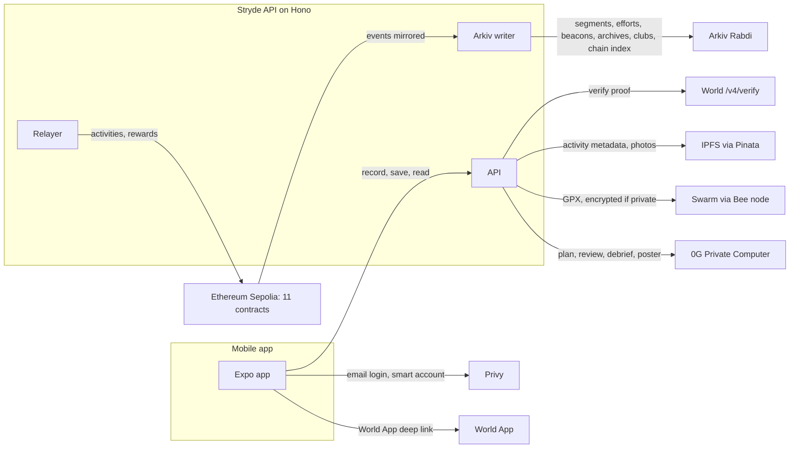

<h1 align="center">
  <picture>
    
  </picture>
</h1>

<p align="center">
  <em><b>Stryde</b> is a Strava-style fitness app where athletes own their runs, records and reputation. Record a run, race segments, claim territory and train with an AI coach, with blockchain doing the ownership quietly underneath.</em>
</p>

<p align="center">
  <a href="https://github.com/swarooppatilx/stryde/actions/workflows/ci.yml"></a>
  <a href="LICENSE"></a>
  
  
  <a href="https://ethglobal.com/events/mumbai"></a>
  <a href="https://ethglobal.com/showcase/stryde-yh9p9"></a>
</p>

<p align="center">
  <a href="https://rabdi.explorer.arkiv.network/address/0x47d877a30be79E3b1b0926943d675CD22f4B914a"></a>
  <a href="arkiv/swarm.md"></a>
  <a href="ZEROG.md"></a>
  <a href="FEEDBACK-WORLD.md"></a>
</p>

<p align="center">
  
</p>

---

## Contents

- [ETHGlobal Mumbai submission](#ethglobal-mumbai-submission)
  - [Starting point](#starting-point)
  - [What we built at Mumbai](#what-we-built-at-mumbai)
  - [What's next](#whats-next)
- [Features](#features)
- [Demo video](#demo-video)
- [Architecture](#architecture)
- [Stack](#stack)
- [Project Structure](#project-structure)
- [Quick Start](#quick-start)
- [Environment](#environment)
- [Commands](#commands)
- [Deployed Contracts (Sepolia)](#deployed-contracts-sepolia)
- [Arkiv + Swarm](#ethglobal-mumbai-continuity-arkiv--swarm)
- [Stryde Coach on 0G](#ethglobal-mumbai-stryde-coach-on-0g-private-computer)
- [World ID IDKit](#ethglobal-mumbai-continuity-world-id-idkit)
- [Before Mumbai: ETHOnline 2026](#before-mumbai-ethonline-2026)
- [How we used AI](#how-we-used-ai)
- [Team](#team)
- [License](#license)

---

## ETHGlobal Mumbai submission

Stryde is a **Continuity Track** project. It was first built at [ETHOnline 2026](https://ethglobal.com/showcase/stryde-yh9p9), and at Mumbai we added three things on top of it. Only the work listed under [What we built at Mumbai](#what-we-built-at-mumbai) is new.

| Prize | What we added at Mumbai | Judging docs |
|---|---|---|
| **Arkiv: Build on Arkiv (existing projects)** + **Swarm bonus** | Segments, segment leaderboards, live run sharing, clubs and a mirror of our chain events on Arkiv. Every run's GPX on Swarm, linked from a per-run Arkiv entity, encrypted for private routes | [`arkiv/`](arkiv/): [schema](arkiv/schema.md), [how we use it](arkiv/how-you-use-arkiv.md), [why Arkiv](arkiv/why-arkiv.md), [reach](arkiv/reach.md), [friction](arkiv/friction.md), [Swarm](arkiv/swarm.md) |
| **0G: Keep Building on 0G** | Stryde Coach: a daily training plan, a post-run review, a voice debrief and a run poster, all inferred on 0G Private Computer, each with its 0G request id | [`ZEROG.md`](ZEROG.md) |
| **World: [Cont] Best Use of IDKit** | The Athlete Pass: STRD rewards are paid only to accounts with a server-verified World ID, one human per earning account. Recording runs never asks for it | [`FEEDBACK-WORLD.md`](FEEDBACK-WORLD.md) |

| | |
|---|---|
| Demo video | On our ETHGlobal Mumbai submission page; the timestamps are [below](#demo-video) |
| Live demo | Android APK from the EAS `preview` profile, or run it yourself with the [Quick Start](#quick-start) |
| Contracts | 11 contracts on Ethereum Sepolia, [listed below](#deployed-contracts-sepolia) |
| Arkiv writer wallet | [`0x47d877a30be79E3b1b0926943d675CD22f4B914a`](https://rabdi.explorer.arkiv.network/address/0x47d877a30be79E3b1b0926943d675CD22f4B914a) on Rabdi (chain `7794095`) |
| One Arkiv query you can run | `node arkiv/query.mjs` (no wallet or key needed) |
| 0G request ids | Listed in [`ZEROG.md`](ZEROG.md#request-ids-live-calls), and shown under every coach answer in the app |

### Starting point

- **Last commit before the event:** [`46fd052`](https://github.com/swarooppatilx/stryde/commit/46fd052) on 2 November 2026, "test: add record run script for a connected device".
- **Previous submission:** [Stryde at ETHOnline 2026](https://ethglobal.com/showcase/stryde-yh9p9), submitted at [`3e89a64`](https://github.com/swarooppatilx/stryde/commit/3e89a64) on 13 September 2026.
- **What existed then:** the app, the 11 contracts, World ID verification mirrored onchain, ENS names, Privy wallets, The Graph, and Arkiv used only for server-written social records. There was no 0G, no Swarm, no segments, live sharing or route archives on Arkiv, and no reward gate.

### What we built at Mumbai

All dates are 2026, IST. The full history is in `git log 46fd052..main`.

| Date | Area | What changed | Commits |
|---|---|---|---|
| 5 Nov, night | Hardening | Privacy zones on imported activities, season restart, World verify mirror retries, Arkiv renewal logging | `d53989c` to `3b7a132` |
| 6 Nov, morning | Arkiv | Chain index mirror: the feed, athlete pages, seasons, territories and clubs read Sepolia events from Arkiv | `c75469d`, `5302cc1`, `45b603b` |
| 6 Nov, morning | Arkiv | Club feed, settings, roles and join requests as `club_record` entities | `9bf6fd2`, `90c3644` |
| 6 Nov, morning | Arkiv | Segments, efforts and leaderboards, heart-rate Proof of Sweat scoring, live beacons | `e4551d7`, `c90689f`, `73d5065` |
| 6 Nov, morning | World | Athlete Pass and human-presence checks; the relayer holds rewards until the pass exists | `9c347b3`, `27affb7`, `fe3377d` |
| 6 Nov, afternoon | World | Orb Proof of Human for the pass with configurable credentials; only trust proofs from the configured environment | `880f851`, `3056771` |
| 6 Nov, afternoon | 0G | Stryde Coach on 0G: post-run review, voice debrief, run poster and daily plan | `f114643` |
| 6 Nov, evening | Swarm | Every run's GPX on Swarm with a per-run Arkiv entity; private routes open only for the athlete's signed session | `b8ead39` |
| 6 Nov, evening | World | Overlapping polls settle once, step-up bound to its pass, badge mirrored only to registered wallets | `b7c2c81` to `aea26ab` |
| 6 Nov, evening | 0G | The plan cites the athlete's own training facts and safety limits; model fallback; TEE and cost chips; request ids on the coach screen | `55664fc` to `3585473` |
| 6 Nov, night | 0G, Swarm | Reasoning turned off so replies aren't cut off; routes uploaded as named GPX files | `9e374ea`, `1651442` |
| 7 Nov, early | Arkiv | Attested entities written readonly, beacon ownership guarded, judging docs | `7aa620d`, `c572175` |
| 7 Nov, early | 0G | Server-wide coach budget, router request ids, retries | `ca3e2c8` |
| 7 Nov, early | World | The pass records which credential made it; IDKit doc rewritten | `016a43c` |

### What's next

1. **Google Play internal testing, then closed testing**, using the checklist in [`docs/PLAY-LAUNCH-CHECKLIST.md`](docs/PLAY-LAUNCH-CHECKLIST.md). The Arkiv keys and the daily renewal job are already in the production API config.
2. **First club pilot on 8 December 2026:** the "December First Run" with the Pune Trail Runs club, with segments seeded on their weekly route.
3. **Selfie Check as the default Athlete Pass** once World enables it for our app. It's one setting (`WORLD_PASS_CREDENTIALS`).
4. **Sign in with your own 0G account,** so athletes can spend their own daily iAI credits on the coach (design in [`ZEROG.md`](ZEROG.md#the-iai-bonus-not-entered-yet)).
5. **Arkiv mainnet** when it launches; the network is one config object.

---

## Features

- **Record**: GPS-tracked runs, walks and rides with an onchain proof (hash commitment plus IPFS metadata)
- **Archive**: every run's GPX on Swarm, encrypted when the route is private, with "Open on Swarm", "View on Arkiv" and "Download GPX" on each run
- **Claim**: territory capture from route coordinates
- **Race**: segments near you, segment leaderboards and "your best" while recording, all on Arkiv
- **Share live**: send a friend a link that follows your run and expires on its own when you stop
- **Coach**: Stryde Coach on 0G writes today's plan, reviews each run, hears your voice debrief and paints a run poster
- **Compete**: seasons, challenges, clubs, events and leaderboards ranked by distance, territory and achievements
- **Earn, once per human**: STRD rewards need a World ID Athlete Pass, so one person can't farm many accounts
- **Own**: soulbound achievement badges, ENS names and portable reputation

---

## Demo video

The app demo runs from 0:00 to 3:12.

| Time | What you see | Built with |
|---|---|---|
| 0:15 to 0:27 | Get an Athlete Pass: World App asks for Proof of Human, then the pass is active | World ID |
| 0:30 | The home feed | Arkiv chain index |
| 0:33 to 0:42 | Record a run, and start sharing it live | Sepolia, Arkiv |
| 0:45 to 0:54 | A friend opens the live link and follows the run | Arkiv beacon |
| 1:03 to 1:09 | Save the run. The route goes to Swarm and the archive to Arkiv | Swarm, Arkiv, Sepolia |
| 1:09 to 1:33 | The coach reviews the run, and the review is shared | 0G |
| 1:36 to 1:42 | The run's proof card, then the archive on the Arkiv explorer | Swarm, Arkiv |
| 1:45 to 2:30 | Challenges, a club with posts and an invite QR code, and a club event | Sepolia, Arkiv |
| 2:33 to 2:45 | Segments near you, a segment leaderboard and the segment on the Arkiv explorer | Arkiv |
| 2:51 to 3:09 | The run poster, a voice debrief and the next session, each with its 0G request id | 0G |

---

## Architecture



- **Sepolia** holds what needs ownership and money: profiles, activities, territory, seasons, badges, challenges and STRD.
- **Arkiv** holds what the app queries and what should expire: segments and leaderboards, live beacons, route archives, clubs, social records and the chain-event mirror that feeds the app.
- **Swarm** holds the full GPX of every run; the Arkiv route archive points to it. **IPFS** holds activity metadata and photos.
- **0G** runs every coach answer. **World ID** is checked on the server before the relayer pays any reward.

---

## Stack

| Layer | Tech |
|-------|------|
| Mobile | Expo, React Native, Expo Router, Ant Design, Mapbox Maps SDK |
| Auth & Wallet | Privy (email OTP, smart accounts, sponsored gas) |
| API | Hono (World ID, IPFS and Swarm uploads, relayer, Arkiv writer, coach) |
| Contracts | Solidity, Foundry (290+ tests) on Ethereum Sepolia |
| Data layer | Arkiv Rabdi testnet: segments, efforts, beacons, route archives, clubs, social, and a mirror of our chain events |
| Indexing | The Graph (Substreams and a Subgraph) and the Arkiv event mirror |
| Storage | IPFS via Pinata (activity metadata, photos); Swarm via our Bee node (GPX routes) |
| AI | 0G Private Computer: 0gm-1.0, whisper-large-v3, Seedream |
| Identity | ENSv2 (human-readable names on Sepolia) |
| Sybil Resistance | World ID (IDKit 4: Selfie Check, Proof of Human) |
| Monorepo | Turborepo, Yarn Berry |

---

## Project Structure

```
stryde/
├── apps/
│   ├── mobile          # Expo React Native (main app)
│   └── web             # Next.js landing page
├── packages/
│   ├── api             # Hono server (World ID, IPFS, Swarm, Arkiv, relayer, 0G coach)
│   ├── shared          # Types, constants, viem services
│   ├── contracts       # Solidity (Foundry)
│   ├── subgraph        # The Graph (schema + mappings)
│   ├── mcp             # Stryde Coach MCP server for the athlete's own agent
│   └── typescript-config
├── arkiv/              # Arkiv and Swarm judging docs, plus query.mjs
├── ZEROG.md            # Stryde Coach on 0G
└── FEEDBACK-WORLD.md   # World ID: trust event, credential choice, debrief
```

---

## Quick Start

**Prerequisites:** Node 20+, [Yarn Berry](https://yarnpkg.com/) 4.18, [Foundry](https://getfoundry.sh/), [socat](https://linux.die.net/man/1/socat).

```bash
# Install dependencies
yarn install

# Start local chain
anvil --port 8546 --host 127.0.0.1 &
socat TCP-LISTEN:8545,fork,reuseaddr TCP:127.0.0.1:8546 &

# Deploy contracts
cd packages/contracts && bash scripts/deploy-local.sh

# Start the API
cd packages/api && node --env-file=.env --import tsx src/dev.ts

# Start the mobile app
cd apps/mobile && npx expo start
```

### Run against Sepolia from your machine, on a real phone

This is how we run the demo build: the API on a laptop, reachable from any phone through a tunnel.

1. **Bee node for Swarm:** start [Swarm Nook](https://www.ethswarm.org/) (it runs Bee on `localhost:1633`) and set `SWARM_POSTAGE_BATCH_ID` to a usable batch.
2. **API:** `cd packages/api && node --env-file=.env --import tsx src/dev.ts`. It listens on `:3001`; `GET /api/health` should answer `"status":"ok"`.
3. **Tunnel:** `cloudflared tunnel --url http://localhost:3001`, and copy the `https://….trycloudflare.com` URL it prints.
4. **App:** set `EXPO_PUBLIC_API_URL` in `apps/mobile/.env` to that URL, then `cd apps/mobile && npx expo start --clear`. The URL is baked in at bundle time, so restart Metro with `--clear` every time the tunnel URL changes.

Teammates building on their own phones only need the tunnel URL in their `apps/mobile/.env`; they don't run their own API or tunnel. EAS `preview` and `sandbox` builds use `https://stryde-api.vercel.app` instead (set in `apps/mobile/eas.json`).

---

## Environment

Full lists with comments are in `apps/mobile/.env.example` and `packages/api/.env.example`. The main ones:

**Mobile** (`apps/mobile/.env`):
```
EXPO_PUBLIC_CHAIN_MODE=ethereum-sepolia      # or local
EXPO_PUBLIC_RPC_URL=...
EXPO_PUBLIC_API_URL=http://127.0.0.1:3001    # or your tunnel URL
EXPO_PUBLIC_API_KEY=                         # must match API_KEY on the API
EXPO_PUBLIC_PRIVY_APP_ID=...
EXPO_PUBLIC_PRIVY_CLIENT_ID=...
EXPO_PUBLIC_WORLD_APP_ID=...
EXPO_PUBLIC_WORLD_RP_ID=...
EXPO_PUBLIC_WORLD_ENVIRONMENT=sandbox
EXPO_PUBLIC_USE_SMART_WALLET=true
```

**API** (`packages/api/.env`):
```
PORT=3001
RPC_URL=...
RELAYER_PRIVATE_KEY=...
RELAYER_CHAIN_ID=11155111
API_KEY=                                     # optional; the app sends it as X-API-Key

# IPFS
PINATA_API_KEY=...
PINATA_SECRET_KEY=...

# Arkiv (Rabdi)
ARKIV_PRIVATE_KEY=...
ARKIV_RABDI_ACCESS_KEY=...

# Swarm
SWARM_BEE_URL=http://localhost:1633
SWARM_POSTAGE_BATCH_ID=...
SWARM_GATEWAY_URL=https://api.gateway.ethswarm.org
SWARM_REF_SECRET=...

# World ID
WORLD_APP_ID=...
WORLD_RP_ID=...
WORLD_RP_SIGNING_KEY=...
WORLD_ENVIRONMENT=sandbox
WORLD_PASS_CREDENTIALS=proof_of_human        # selfie,proof_of_human once Selfie Check is enabled

# 0G
ZEROG_API_KEY=sk-...
```

---

## Commands

Run from the repo root, across all workspaces:

| Command | Description |
|---------|-------------|
| `yarn build` | Build every app and package |
| `yarn dev` | Run every app and package in dev mode |
| `yarn lint` | Lint everything (Biome) |
| `yarn format` | Format everything (Biome) |
| `yarn check` | Biome check (lint + format, no writes) |
| `yarn check-types` | Type-check every workspace |
| `yarn turbo run test` | Run tests in every workspace that has one |

Scope any of the `turbo run` tasks to one workspace with `--filter`, e.g. `yarn turbo run test --filter=@repo/api`.

---

## Deployed Contracts (Sepolia)

Chain `11155111`. The current deployment starts at block `12063931`; the app's feed starts at block `12078041`. Addresses are also in [`packages/shared/src/constants.ts`](packages/shared/src/constants.ts).

| Contract | Address |
|---|---|
| ProfileRegistry | [`0x348CE6aF8eA0C50fb44F284dCCA73b7EE5112314`](https://sepolia.etherscan.io/address/0x348CE6aF8eA0C50fb44F284dCCA73b7EE5112314#code) |
| ActivityRegistry | [`0x30a910fc25F0977907Af86345c0B26C34e7d2439`](https://sepolia.etherscan.io/address/0x30a910fc25F0977907Af86345c0B26C34e7d2439#code) |
| TerritoryRegistry | [`0x22802b1C6fda5CA6FBC519830879a17214DbA1e2`](https://sepolia.etherscan.io/address/0x22802b1C6fda5CA6FBC519830879a17214DbA1e2#code) |
| SeasonManager | [`0xfc42018ea93384FA6703d0Eb72656C67261D1732`](https://sepolia.etherscan.io/address/0xfc42018ea93384FA6703d0Eb72656C67261D1732#code) |
| AchievementRegistry | [`0x537F289b59b9944e14978a23f57133B738747f81`](https://sepolia.etherscan.io/address/0x537F289b59b9944e14978a23f57133B738747f81#code) |
| ChallengeRegistry | [`0x6E196c21292E0eDE7748A04A5a62bE0b6ae6004c`](https://sepolia.etherscan.io/address/0x6E196c21292E0eDE7748A04A5a62bE0b6ae6004c#code) |
| TerritoryNFT | [`0xfC9044241B4edA72779d9F9876426D256048531B`](https://sepolia.etherscan.io/address/0xfC9044241B4edA72779d9F9876426D256048531B#code) |
| MoveToEarnToken (STRD) | [`0x6Cc5211470De17d69B3208e26B08fFAD0b6260F6`](https://sepolia.etherscan.io/address/0x6Cc5211470De17d69B3208e26B08fFAD0b6260F6#code) |
| GroupRegistry | [`0xeeBBd3aAADcC95919e6f3a78E3A2cdA57D0a3241`](https://sepolia.etherscan.io/address/0xeeBBd3aAADcC95919e6f3a78E3A2cdA57D0a3241#code) |
| SocialRegistry | [`0xfc97445a56b61471720EF9e2bb0759d8d3c76561`](https://sepolia.etherscan.io/address/0xfc97445a56b61471720EF9e2bb0759d8d3c76561#code) |
| EventRegistry | [`0xDead8aA0b3840f272c8293E6DD34932cF5a7f027`](https://sepolia.etherscan.io/address/0xDead8aA0b3840f272c8293E6DD34932cF5a7f027#code) |

### Indexing

- **Arkiv event mirror:** the feed, athlete pages, season leaderboard, territories and club members read Sepolia events mirrored into Arkiv (`idx_event`). This is what the app uses today.
- **The Graph:** [subgraph v0.6.0](https://api.studio.thegraph.com/query/1760059/stryde/v0.6.0) from [Subgraph Studio](https://thegraph.com/studio/subgraph/stryde) indexes the previous deployment from ETHOnline, so the app no longer reads it. `packages/subgraph` already targets the current addresses for the next deploy.

---

## ETHGlobal Mumbai (Continuity): Arkiv + Swarm

Stryde is a Continuity Track project: it was built at ETHOnline 2026, and we kept building it before Mumbai. Judge only what is listed under "Added at Mumbai".

**Before Mumbai** (ETHOnline and September 2026):
- The app, contracts, World ID, ENS, Privy and The Graph.
- Arkiv was used only for **server-written social records**: `post`, `follow`, `comment_like`, `profile_about`, `report`, `push_token`, `notify_checkpoint` and the `season_contribution` ledger, with a renewal job. Commits `3d69628`, `ee48247` and `93e7629`.
- No segments, efforts, beacons, route archives, chain index on Arkiv, or Swarm.

**Added at Mumbai** (6 November 2026 onward):

| What | Arkiv entities | Commits |
|---|---|---|
| Chain index mirror: the feed, athlete pages, season leaderboard, territories and club members read Sepolia events from Arkiv instead of a subgraph | `idx_event`, `idx_checkpoint` | `c75469d`, `45b603b` |
| Clubs: feed, settings, roles and join requests | `club_record` | `9bf6fd2` |
| Segments, segment efforts and leaderboards, Proof of Sweat scoring | `stryde_segment`, `stryde_effort` | `e4551d7`, `c90689f`, `73d5065` |
| Live Beacon: share a run live, and it expires 10 minutes after the last update | `stryde_beacon` | `c90689f`, `73d5065` |
| Every run's GPX on **Swarm**, with a per-run Arkiv entity; private routes encrypted, with sealed references | `stryde_route_archive` | `b8ead39` ([#33](https://github.com/swarooppatilx/stryde/pull/33)), `9e374ea` ([#37](https://github.com/swarooppatilx/stryde/pull/37)) |
| Fixes from reviewing our own Arkiv use: readonly attested entities, renewal skips transferred entities, beacon run ids tied to their athlete, the access key kept out of URLs, a creator check on segment lookups | | see [`arkiv/friction.md`](arkiv/friction.md) |

**Network:** Arkiv **Rabdi** testnet (chain `7794095`), through `@arkiv-network/sdk`.

**Wallet that writes our entities:** [`0x47d877a30be79E3b1b0926943d675CD22f4B914a`](https://rabdi.explorer.arkiv.network/address/0x47d877a30be79E3b1b0926943d675CD22f4B914a). Segments, efforts and route archives are then transferred to the athlete's wallet.

**One query you can run** (no wallet or key needed):

```bash
yarn install
node arkiv/query.mjs            # Stryde segments near Mumbai + one athlete's Swarm route archives
```

This is the core of it, from [`arkiv/query.mjs`](arkiv/query.mjs):

```js
client.select().from(Segments).where(startsWith('geohash', 'te7u')).createdBy('0x47d877a30be79E3b1b0926943d675CD22f4B914a').limit(20).fetch()
```

**Docs:**
- [`arkiv/schema.md`](arkiv/schema.md)
- [`arkiv/how-you-use-arkiv.md`](arkiv/how-you-use-arkiv.md)
- [`arkiv/why-arkiv.md`](arkiv/why-arkiv.md)
- [`arkiv/reach.md`](arkiv/reach.md)
- [`arkiv/friction.md`](arkiv/friction.md)
- [`arkiv/swarm.md`](arkiv/swarm.md)

---

## ETHGlobal Mumbai: Stryde Coach on 0G Private Computer

Stryde Coach is a daily plan, a post-run review, a voice debrief and a run poster. Every answer is inference on 0G Private Computer (0gm-1.0, whisper-large-v3 and Seedream), and each one shows its 0G request id in the app. If 0G is removed, the coach and everything it writes disappears.

**New at Mumbai:** all of it. Stryde had no 0G and no AI before the event (first commit `f114643`, 6 November).

| Coach feature | 0G models | In the video |
|---|---|---|
| Post-run review | 0gm-1.0 | 1:09 to 1:33 |
| Run poster | 0gm-1.0 writes the scene, Seedream paints it | 2:51 to 2:57 |
| Voice debrief and next session | whisper-large-v3, then 0gm-1.0 | 3:03 to 3:09 |
| Daily plan | 0gm-1.0 | Profile, then AI Coach |

**Live request ids** from 6 November 2026, for example `7f3e2cf3-e73d-493e-90f0-891798f3182a` (review) and `4251ded9-4403-4d7c-ba21-f4ce02095cf9` (poster). The full table is in [`ZEROG.md`](ZEROG.md#request-ids-live-calls).

**Code:** the 0G router client is [`packages/api/src/lib/zeroG.ts`](packages/api/src/lib/zeroG.ts) (`chat` at [line 315](packages/api/src/lib/zeroG.ts#L315)), the prompts and allowances are in [`packages/api/src/lib/coach.ts`](packages/api/src/lib/coach.ts), and the routes are in [`packages/api/src/routes/coach.ts`](packages/api/src/routes/coach.ts).

Setup, how to try it with `curl`, and what we fixed while testing: [`ZEROG.md`](ZEROG.md).

---

## ETHGlobal Mumbai (Continuity): World ID IDKit

Recording runs is free for everyone. Minting STRD for a run needs an Athlete Pass: one World ID check, verified on our server with World's `/api/v4/verify` before any reward is paid. Without it, the run stays saved and the reward waits.

Selfie Check is the credential that fits Stryde best. World returns `feature_unavailable` for it on our app, so the demo uses Orb Proof of Human; switching back is one setting (`WORLD_PASS_CREDENTIALS`).

**Before Mumbai,** World ID was a one-time verified badge. **At Mumbai,** it became the gate on the one action that pays money, with server-side nullifier uniqueness, replay protection, sessions and a Proof of Human step-up.

| | |
|---|---|
| Trust event | STRD is about to be minted for a run: is one real human behind this earning account, and only this one? |
| Credential | Selfie Check by design, Proof of Human (Orb) in the demo |
| Success path in the video | 0:15 to 0:27 |
| Alternative paths | Cancelled in World App, no Orb credential, same human on a second account, replayed proof. All are covered by `packages/api/src/routes/__tests__/world.presence.test.ts` |
| Code | IDKit requests in [`packages/api/src/routes/world.ts`](packages/api/src/routes/world.ts#L380-L410), the reward gate in [`packages/api/src/routes/relay.ts`](packages/api/src/routes/relay.ts), the policy in [`packages/api/src/lib/humanPresence.ts`](packages/api/src/lib/humanPresence.ts) |

The trust event, why Selfie Check is the minimum sufficient credential, the demo paths and our integration debrief: [`FEEDBACK-WORLD.md`](FEEDBACK-WORLD.md).

---

## Before Mumbai: ETHOnline 2026

Stryde was first submitted at [ETHOnline 2026](https://ethglobal.com/showcase/stryde-yh9p9). Everything in this table existed before Mumbai and is not part of the Mumbai submission.

| Sponsor | Track | What |
|---------|-------|------|
| [The Graph](https://thegraph.com/) | [Composable Products](https://ethglobal.com/events/ethonline2026/prizes/the-graph) | Subgraph indexes all 7 registries, composed queries |
| [World ID](https://world.org/) | [Selfie Check](https://ethglobal.com/events/ethonline2026/prizes/world) | Verified athletes, sybil-resistant leaderboards |
| [ENS](https://ens.domains/) | [Best Integration + ENSv2](https://ethglobal.com/events/ethonline2026/prizes/ens) | Human-readable names via Universal Resolver |
| [Privy](https://privy.io/) | [Best Financial Flow](https://ethglobal.com/events/ethonline2026/prizes/privy) | Email OTP auth, embedded wallet, smart accounts |

---

## How we used AI

We used AI coding assistants (Cursor's agent) throughout. They were used for:
- writing and refactoring code and tests;
- reading the Arkiv and Swarm SDKs and docs;
- running end-to-end checks against Rabdi and our Bee node;
- drafting these docs.

The team chose the features, the data model and the trade-offs, reviewed every change, and tested it on devices. The Arkiv bugs listed in [`arkiv/friction.md`](arkiv/friction.md) were found while reviewing and testing that work.

---

## Team

| Name | GitHub | Worked on |
|---|---|---|
| Swaroop Patil | [swarooppatilx](https://github.com/swarooppatilx) | Contracts, API, Stryde Coach, Swarm |
| Sarvesh Kolte | [renarin-kholin](https://github.com/renarin-kholin) | Mobile app, maps and recording, Proof of Human pass |
| Chinmay Nakwa | [ChinmayNakwa](https://github.com/ChinmayNakwa) | Arkiv data layer, World ID hardening, shared packages |
| Aditya | [adimail](https://github.com/adimail) | API, web app, contracts |
| Manasi Choudhari | [Manasi-Choudhari](https://github.com/Manasi-Choudhari) | Stryde Coach on 0G, Athlete Pass and reward gate |

---

## License

[MIT](LICENSE)
