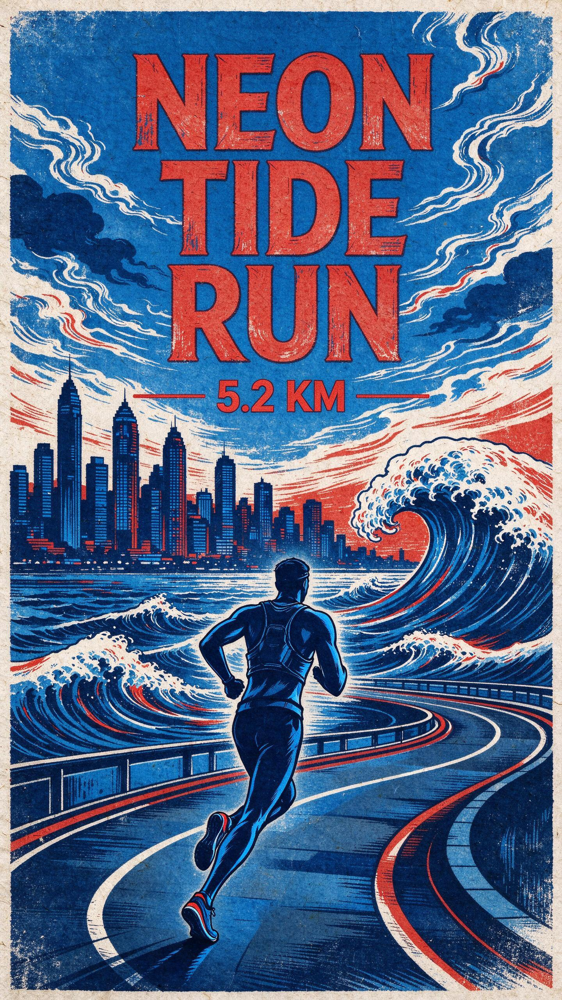

# Stryde Coach: built with 0G Private Computer

**Stryde** is a mobile fitness app: record a run, claim territory, climb season leaderboards. Your activities, badges and rewards live onchain.

**Stryde Coach** is the AI coach inside it, and every coach answer is inference on 0G Private Computer:
- a **daily training plan** written from your last two weeks;
- a **post-run review** of the run you just finished;
- a **voice debrief** you speak into after the run;
- a **run poster** painted from that run, in one of eight art styles.

> **What breaks if 0G is removed:** the coach disappears. No plan for today, no review or poster after a run, and your spoken debriefs are never heard, because every one of those screens is generated on 0G and there is no other model behind them.

<p align="center"></p>
<p align="center"><em>A run poster from a real call on 6 Nov 2026: 0gm-1.0 wrote the scene (request <code>ba1a54cd-cf24-4db7-a334-e829e814c868</code>), then Seedream on 0G painted it (request <code>4251ded9-4403-4d7c-ba21-f4ce02095cf9</code>).</em></p>

## Where 0G is in the main user flow

1. **Morning: Profile, then AI Coach, then "Plan today's session".**
   - 0gm-1.0 reads your last two weeks of activities (up to 14), plus what you said in your debriefs, and writes one session for today: steps, and why this session.
   - "A new one every morning."
2. **Record a run.** Nothing changes here; the run goes onchain as before.
3. **Open the finished run.** The coach card on the run sheet offers three things:
   - **Review:** 0gm-1.0 reads the run's numbers, heart rate and recent history. It returns a headline, what went well, a read on your vitals, what to improve, and what to do next run.
   - **Voice debrief:** you tap and record a short voice note ("legs felt heavy on the hills"). **whisper-large-v3** on 0G transcribes it, then **0gm-1.0** turns it into a note with effort (1–10), feel and tags. The note feeds tomorrow's plan.
   - **Poster:** **0gm-1.0** acts as an art director and writes a scene and title from the run's place, distance and time of day. **Seedream** on 0G paints a 9:16 story poster, which you can save or share.
4. **Every result shows its receipt.** Under each answer the app shows `0G · <model> · <request id>`. Tap it to copy the full request id.

Every response is structured JSON that the app renders as cards, steps and a share image; there is no chat box. The model choice is a pipeline: speech-to-text, then chat, for the debrief; chat, then image, for the poster.

## Why someone comes back tomorrow

- **Today's plan is new every day.** It's built from what you did yesterday and how you said it felt. Yesterday's debrief changes today's session.
- **Every run ends with the coach:** a review, a debrief and a poster worth sharing. Running is a daily habit, and the coach is attached to every session.
- **Allowances reset at 00:00 UTC.** That's the same moment iAI credits refresh. Per wallet, per day: 5 plans, 8 reviews, 6 debriefs, 3 posters.

## Request IDs: live calls

These calls went through our API to the 0G router on 6 November 2026, about 23:15 IST.

| Feature | Model | 0G request id | Cost (USD micro) | Time |
|---|---|---|---|---|
| Daily plan | `0gm-1.0-35b-a3b` | `927aae9e-4cdc-4342-be60-8e7fafaabc67` | 94 | 16.1 s |
| Post-run review | `0gm-1.0-35b-a3b` | `7f3e2cf3-e73d-493e-90f0-891798f3182a` | 204 | 8.2 s |
| Poster: art director | `0gm-1.0-35b-a3b` | `ba1a54cd-cf24-4db7-a334-e829e814c868` | 103 | |
| Poster: painting | `bytedance/seedream-5.0-flash` | `4251ded9-4403-4d7c-ba21-f4ce02095cf9` | 27,000 | 43.6 s (both steps) |

Where to see request ids:
- **In the app:** the receipt row under every plan, review, debrief and poster. Tap to copy.
- **In the API response:** every `/api/coach/*` reply has `zeroG: [{ requestId, model, costUsdMicro }]`, one entry per 0G call. A debrief and a poster each have two.
- **In the API log:** `[coach] review 0x048032 via 0gm-1.0-35b-a3b req=7f3e2cf3-…`
- **On failure:** the error body carries the `requestId` of the failed call, so it can be looked up.

The request id comes from the router's `x_0g_trace.request_id`. The trace also names the provider that served the call (for example `0xf4FB8d2bD856e672b5f9848b0eD235A20079B250`).

## Privacy

- **Posters** are returned to the phone as an image and saved only on the device. The API does not store them.
- **Voice notes** are sent once for transcription and not stored; only the transcript and note are kept, on the phone.
- **The 0G key stays on our API.** The app never sees it; `EXPO_PUBLIC_*` values are public, so the key is never one of them.
- **Run data sent to the coach** is a summary (distance, time, pace, heart rate, place name), not the GPS track.

## The iAI bonus: not entered yet

We do not have "sign in with your 0G account" yet. Today every coach call is paid from the team's 0G credits, with per-wallet daily allowances and a server-wide daily cap.

0G's router has no OAuth. A user's 0G account is the `sk-` API key and the `mk-` management key they create at [pc.0g.ai](https://pc.0g.ai). Our planned design:
1. In the app, "Use my 0G credits": the athlete pastes or scans an `sk-` key and an `mk-` key with only the `account:read` scope. Both are kept in the phone's secure store.
2. Coach calls send the athlete's `sk-` key to our API for that one call. The API uses it instead of the team key and never stores it.
3. The coach screen reads `GET /v1/account/balance` with the `mk-` key, so the athlete watches their daily iAI credits go down with each plan, review and poster.

## Try it

| | |
|---|---|
| Live demo | TODO: link (Android APK or Expo link) |
| Demo video (under 3 min) | TODO: link; the coach is at TODO mm:ss |
| Repo | <https://github.com/swarooppatilx/stryde> (MIT) |

### Run the coach yourself

1. Get an `sk-` key at [pc.0g.ai](https://pc.0g.ai) (Dashboard, then API Keys).
2. In `packages/api/.env`, set:
   ```
   ZEROG_API_KEY=sk-...
   # optional
   ZEROG_BASE_URL=https://router-api.0g.ai/v1
   ZEROG_CHAT_MODEL=0gm-1.0-35b-a3b         # else picked from /v1/models
   ZEROG_IMAGE_MODEL=bytedance/seedream-5.0-flash
   ZEROG_STT_MODEL=whisper-large-v3
   ZEROG_DAILY_PLANS=5  ZEROG_DAILY_REVIEWS=8  ZEROG_DAILY_DEBRIEFS=6  ZEROG_DAILY_POSTERS=3
   ZEROG_DAILY_TOTAL=400                     # all wallets together, per UTC day
   ```
3. Start the API: `yarn install`, then `cd packages/api && node --env-file=.env --import tsx src/dev.ts`. It listens on `:3001`.
4. Ask for today's plan:
   ```bash
   curl -s -X POST http://localhost:3001/api/coach/plan -H 'content-type: application/json' -d '{
     "wallet":"0x0480322cd1111439439d70D25dD2a304001d97eD","today":"2026-11-07",
     "history":[{"activityType":"run","name":"Marine Drive morning","place":"Mumbai",
                 "distanceM":5200,"durationS":1680,"startedAt":"2026-11-06T01:00:00Z"}]}'
   ```
   You get `plan: { title, summary, steps[], why }` and `zeroG: [{ requestId, model, costUsdMicro }]`.
5. The same body with `"activity": {…}` in place of `history` works for `POST /api/coach/review`. Add `"style":"ukiyoe"` for `POST /api/coach/poster`.
6. For the app, follow the [Quick Start](README.md#quick-start). In `apps/mobile/.env`, set `EXPO_PUBLIC_API_URL` to the API. The coach is under Profile, then AI Coach, and on every finished run.

## Code

| File | What it does |
|---|---|
| [`packages/api/src/lib/zeroG.ts`](packages/api/src/lib/zeroG.ts) | The 0G router client: `chat`, `generateImage`, `transcribe`, model discovery from `/v1/models`, retries, and a receipt with the request id and cost for every call |
| [`packages/api/src/lib/coach.ts`](packages/api/src/lib/coach.ts) | Prompts, JSON parsing for the plan, review, debrief and poster direction, the eight poster styles, and daily allowances |
| [`packages/api/src/routes/coach.ts`](packages/api/src/routes/coach.ts) | `POST /api/coach/plan`, `/review`, `/debrief` and `/poster` |
| [`apps/mobile/src/services/coachService.ts`](apps/mobile/src/services/coachService.ts) | The app's calls |
| [`apps/mobile/src/components/coach-plan-card.tsx`](apps/mobile/src/components/coach-plan-card.tsx) | Today's plan |
| [`apps/mobile/src/components/coach-run-card.tsx`](apps/mobile/src/components/coach-run-card.tsx) | Review, debrief and poster on every run |
| [`apps/mobile/src/components/zero-g-receipts.tsx`](apps/mobile/src/components/zero-g-receipts.tsx) | The `0G · model · request id` receipt row |
| Tests | [`packages/api/src/routes/__tests__/coach.test.ts`](packages/api/src/routes/__tests__/coach.test.ts) and [`packages/api/src/lib/__tests__/coach.test.ts`](packages/api/src/lib/__tests__/coach.test.ts) (33 tests) |

## What we fixed while testing on 0G

- **Empty answers.** `0gm-1.0` reasons by default, and the reasoning counts against `max_tokens`, so short budgets came back empty and were about 6× slower. We now send `chat_template_kwargs: { enable_thinking: false }`; a review dropped from about 52 s to about 8 s.
- **Request ids came back as two ids.** The router's `X-Request-ID` header arrives as `"<edge id>, <router id>"`. We now take the router's id from `x_0g_trace.request_id`, so the id in the app is the one 0G's usage history knows.
- **Dropped connections.** A lost connection to the router (`fetch failed`) was not retried, so on venue Wi-Fi the poster silently lost its art director. Connection errors are now retried like 5xx and timeouts.
- **Credit drain.** Allowances are per wallet, and the wallet in a request is not authenticated, so fresh addresses could have spent all our credits. There is now a server-wide daily cap (`ZEROG_DAILY_TOTAL`), and failed calls are refunded.

## Contracts (Ethereum Sepolia, chain 11155111)

The coach itself is offchain; these are the app's contracts.

| Contract | Address |
|---|---|
| ProfileRegistry | `0x348CE6aF8eA0C50fb44F284dCCA73b7EE5112314` |
| ActivityRegistry | `0x30a910fc25F0977907Af86345c0B26C34e7d2439` |
| TerritoryRegistry | `0x22802b1C6fda5CA6FBC519830879a17214DbA1e2` |
| SeasonManager | `0xfc42018ea93384FA6703d0Eb72656C67261D1732` |
| AchievementRegistry | `0x537F289b59b9944e14978a23f57133B738747f81` |
| ChallengeRegistry | `0x6E196c21292E0eDE7748A04A5a62bE0b6ae6004c` |
| TerritoryNFT | `0xfC9044241B4edA72779d9F9876426D256048531B` |
| MoveToEarnToken (STRD) | `0x6Cc5211470De17d69B3208e26B08fFAD0b6260F6` |
| GroupRegistry | `0xeeBBd3aAADcC95919e6f3a78E3A2cdA57D0a3241` |
| SocialRegistry | `0xfc97445a56b61471720EF9e2bb0759d8d3c76561` |
| EventRegistry | `0xDead8aA0b3840f272c8293E6DD34932cF5a7f027` |

## Team

| Name | Telegram | X |
|---|---|---|
| TODO | TODO | TODO |
